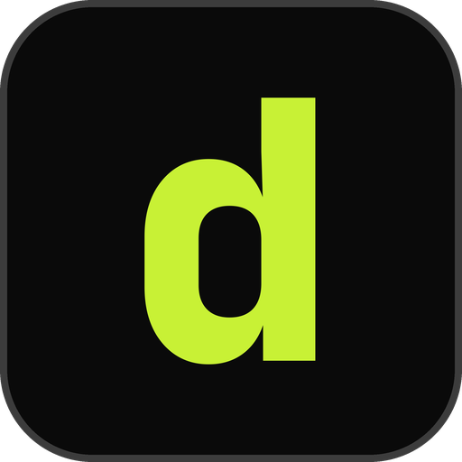

<p align="center"></p>

# dude

No super. Just email. Keyboard-first desktop client for Gmail and Microsoft 365.

[](AI-LICENSE)

https://github.com/user-attachments/assets/b9aec33d-f4af-49ec-88bf-b918c40e68bc


## Download

- Stable: [latest release](https://github.com/dezhidki/dude/releases/latest)
- Nightly: [rolling prerelease](https://github.com/dezhidki/dude/releases/tag/nightly), built from every push to `main`. May be broken.

| OS | File |
|---|---|
| Linux | `dude-<version>-linux-x86_64.AppImage` |
| macOS, Apple silicon | `dude-<version>-mac-arm64.dmg` |
| macOS, Intel | `dude-<version>-mac-x64.dmg` |
| Windows | `dude-<version>-win-x64.exe` (installer) |

Builds are unsigned. First run:

- **macOS**: drag to Applications, then `xattr -cr /Applications/dude.app`. Or right-click the app, then **Open**.
- **Windows**: SmartScreen warns. Click **More info**, then **Run anyway**.
- **Linux**: `chmod +x dude-*.AppImage`, then run it.

## Features

- **Sign-in**: Gmail or Microsoft 365 over OAuth (code + PKCE). Uses Thunderbird's public OAuth client registrations. Works where your org allows only Thunderbird.
- **Mail**: IMAP + SMTP with XOAUTH2. Conversations grouped by Gmail thread id or reply chain, never by subject alone.
- **Fast**: folder lists cached on disk, open instantly. IMAP IDLE push: new mail in seconds. Timer check as backup (15 s to 5 min).
- **Split inbox**: Important / Other (mailing lists go to Other). Add custom splits from a search query.
- **Triage**: done, remind me (snooze), star, read/unread, trash, spam, move, label (Gmail), mute, block sender, unsubscribe, "Get Me To Zero" bulk done.
- **Compose**: markdown (bold, italic, code, lists, links), signature, To/Cc suggestions from your mail, snippets, attachments up to 25 MB each, drafts saved to the server.
- **Undo send**: off, 3, 5, 10 or 20 s.
- **Send later**: kept locally. App must be open when due. No attachments.
- **Typed times** for remind, send later, events, jump to date: `8 am`, `2h`, `3 days`, `mon 9:30`, `aug 7`, `next week`, `this weekend`, `tomorrow 2 pm 30 min`.
- **Calendar**: day pane beside mail, week view, create/edit/delete events, guests get real invites. Google: Calendar API, no extra step. Microsoft 365: run **Connect Calendar** once (Exchange Web Services). Not connected: event kept locally, invite sent as iCalendar mail.
- **Todo board**: week as columns, one per day, plus someday. Todos carry labels, tasks, notes and mail. `D` on a mail makes one. Drag a card to move it. Filter by label. Settings: weekends, declined events, week start, for week and board.
- **Invites**: RSVP yes/maybe/no from the mail. Answered in your calendar when connected, else by iCalendar reply mail.
- **Files**: PDF and image viewer inside the app. Open or save to Downloads.
- **Desktop**: tray icon with unread count, new-mail notifications (important / all / off), close hides to tray, one instance only.
- **Command palette**: every action, searchable by name.
- **Themes**: dark (carbon) or light.

Search words: `from:` `to:` `cc:` `bcc:` `subject:` `domain:` `"phrase"` `-word` `in:` `label:` `is:unread` `is:read` `is:starred` `has:attachment` `filename:` `larger:5M` `smaller:` `before:2025/06/01` `after:` `older_than:3d` `newer_than:`. Gmail: query passed as is. Microsoft 365 without `in:`: searches Inbox, Done and Sent.

## Keys

`Mod` = `Ctrl`, or `⌘` on macOS. `?` shows all keys in the app.

| Key | Action |
|---|---|
| `Mod K` | command palette |
| `J` / `K` | next / previous conversation |
| `↓` `↑` or `N` `P` | next / previous message (in a thread) |
| `Enter` | open. In a thread: expand message, else reply all |
| `Esc` | back |
| `←` | folder menu |
| `Tab` / `Shift Tab` | next / previous split |
| `/` | search |
| `E` / `Shift E` | mark done / not done |
| `H` | remind me |
| `S` / `U` | star / read-unread |
| `#` / `!` | trash / spam |
| `V` / `L` | move / label (Gmail) |
| `X` / `Mod A` / `Mod Shift A` | select / select all / select all from here |
| `Z` | undo (also undo send) |
| `O` / `Shift O` | expand message / all messages |
| `Shift N` | show new messages in thread |
| `C` / `R` / `F` | compose / reply / forward |
| `;` | insert snippet |
| `Mod Enter` | send. In event form: save |
| `Mod Shift L` | send later |
| `Mod Shift C` / `Mod Shift B` | add Cc / Bcc |
| `Mod Shift A` | attach (in composer) |
| `Mod Shift ,` | discard draft |
| `Mod ,` | settings |
| `G` then `I` `O` `S` `D` `T` `E` `H` `A` `!` `#` | Important, Other, Starred, Drafts, Sent, Done, Reminders, All Mail, Spam, Trash |
| `0` | day calendar beside mail |
| `2` / `1` | week view / back to mail |
| `B` | create event |
| `-` / `=` | previous / next day. Week view: previous / next week, also `←` `→` |
| `T` | today (week view) |
| `Y` / `M` / `N` | answer an open invite |
| `3` | todo board |
| `D` | new todo. On a mail: todo with that mail |

## Try it in a browser

Web build runs a mock demo mailbox. No account needed.

```sh
(cd app && npm ci && npm run build)        # builds app/web into app/dist (Vite)
python3 -m http.server -d app/dist 8000    # or: npx serve app/dist
```

Open the page, click **go**, then **try demo**. Real mail needs the desktop app.

## Run / build from source

```sh
(cd app && npm ci)  # the UI's build tools
cd app/desktop
npm ci
npm start           # builds the UI, starts Electron
npm run package     # installer for the current OS, into app/desktop/dist
```

- Code: strict [TypeScript](https://www.typescriptlang.org). `app/web` is the UI ([Solid](https://docs.solidjs.com) 2 components, built with [Vite](https://vite.dev)), `app/desktop` the Electron app and mail engine (Electron runs its `.ts` files as they are), `app/web/api.ts` what the two say to each other. Tests in `app/tests`, images in each part's `assets`.
- Tests: `cd app && npm test` (plain Node 24; the mail engine's tests need `app/desktop` installed).
- Lint, format and types: `cd app && npm ci && npm run lint` ([Biome](https://biomejs.dev), then `tsc`). `npm run fix` applies Biome's fixes.
- UI smoke test: `cd app && npm run smoke` (needs `app/desktop` installed). Clicks through the demo in a hidden window and fails on any warning.
- Separate profile: `DUDE_PROFILE=/some/folder npm start`.

## Release

- CI: `.github/workflows/build.yml`. Builds Linux, macOS, Windows on every push to `main`. Lint, types, tests and the UI smoke test run first.
- Push to `main` replaces the `nightly` prerelease.
- Versioned release: push a tag. Version comes from the tag.

```sh
git tag v0.2.1 && git push --tags
```

## Privacy

- No dude server. App talks only to Google or Microsoft: sign-in, IMAP, SMTP, calendar.
- Tokens: encrypted with the OS keychain (Electron `safeStorage`). No keychain available? Stored unencrypted in a file only your user can read (mode `0600`).
- Folder-list cache, reminders, snippets, todos, settings, `dude.log`: local, in the profile folder.
- HTML mail renders in a sandboxed frame. Remote images in it do load.

## License

MIT. See [LICENSE](LICENSE).

Built with AI (Claude Code). Provenance: [AI-LICENSE](AI-LICENSE), [.ai-attestation.yaml](.ai-attestation.yaml). Refresh before a release:

```sh
npx @korext/ai-attestation scan && npx @korext/ai-license generate
```
